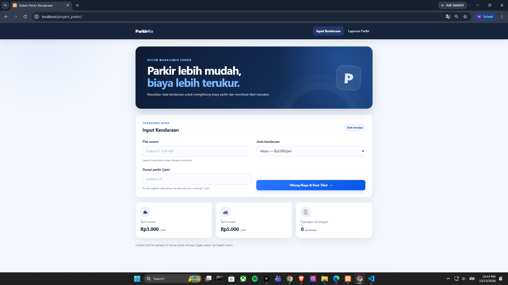
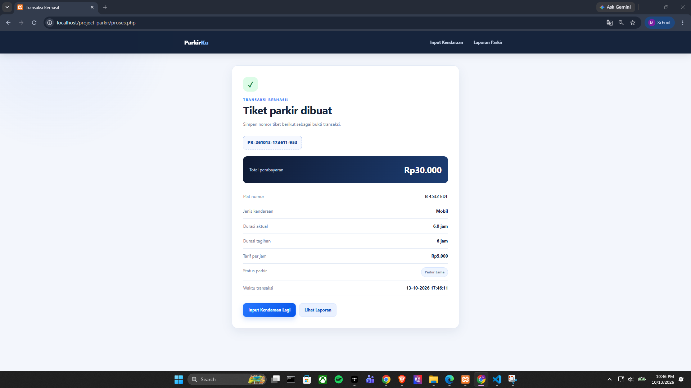
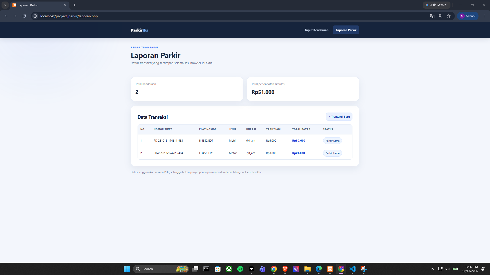

# Proyek UTS PBW — Sistem Parkir Kendaraan

## Deskripsi
Mini aplikasi PHP untuk simulasi transaksi parkir kendaraan. Proyek mengintegrasikan materi Pertemuan 1–7: PHP dan XAMPP, procedural dan OOP, variabel dan tipe data, konstanta, operator, manipulasi string, WHILE, DO-WHILE, dan FOR.

## Fitur
- Form input plat nomor, jenis kendaraan, dan durasi parkir.
- Validasi data.
- Perhitungan biaya parkir otomatis.
- Pembuatan nomor tiket.
- Status parkir berdasarkan durasi.
- Laporan transaksi dan total pendapatan simulasi.
- Tampilan responsif dengan CSS.

## Aturan tarif simulasi
- Motor: Rp3.000 per jam.
- Mobil: Rp5.000 per jam.
- Durasi tagihan dibulatkan ke atas per jam, minimum 1 jam.
- Status: Normal (<= 2 jam), Menengah (> 2 sampai 5 jam), Parkir Lama (> 5 jam).
- Tarif hanya contoh untuk keperluan tugas.


## Struktur folder
```text
project_parkir_kelompok/
├── index.php
├── proses.php
├── laporan.php
├── functions.php
├── classes/Kendaraan.php
├── data/sample.php
├── assets/css/style.css
└── README.md
```

## Bukti materi wajib
| Materi | Implementasi |
|---|---|
| P1 — PHP/XAMPP | Semua halaman `.php`, dijalankan melalui localhost |
| P2 — Procedural + OOP | `hitungBiayaParkir()`, `tentukanStatusParkir()`, class `Kendaraan`, object `$kendaraan` |
| P3 — 5 tipe data | String, integer, float, boolean, array; konstanta tarif; konversi durasi ke float |
| P4 — Operator + string | Aritmatika, ternary, perbandingan, logika; `trim()`, `strtoupper()`, `preg_replace()`, `strlen()`, `number_format()` |
| P5 — WHILE | `validasiDataParkir()` pada `functions.php` |
| P6 — DO-WHILE | Membuat nomor tiket unik pada `proses.php` |
| P7 — FOR + tabel | Menghitung pendapatan dan menampilkan laporan pada `laporan.php` |

## Contoh pengujian
1. Motor, 2.5 jam → durasi tagihan 3 jam → Rp9.000.
2. Mobil, 3 jam → Rp15.000.
3. Durasi 0 atau lebih dari 720 jam → ditolak.
4. Jenis selain Motor/Mobil → ditolak.
5. Plat kosong → ditolak.

## Pembagian tugas (isi sesuai anggota kelompok)

### 1. Mohammad Fadlan Devandi — 4523210065

- Membuat `functions.php` untuk perhitungan tarif dan validasi input.
- Membuat class `Kendaraan.php` dengan menerapkan konsep Object-Oriented Programming (OOP).
- Mengembangkan `proses.php` untuk menghitung biaya parkir dan membuat tiket parkir.
- Menerapkan variabel, tipe data, konstanta, operator, manipulasi string, serta perulangan `WHILE` dan `DO-WHILE`.
- Menyusun README GitHub dan ringkasan PDF proyek.

### 2. Muhammad Rashaqa — 4523210078

- Membuat `index.php` sebagai halaman input kendaraan.
- Mengembangkan `laporan.php` untuk menampilkan transaksi menggunakan perulangan `FOR`.
- Merapikan tampilan aplikasi melalui `assets/css/style.css`.
- Mengambil lima screenshot dokumentasi aplikasi, meliputi halaman utama, form input, hasil transaksi, output loop, dan validasi input.


## Screenshot Aplikasi
### 1. Halaman Utama


### 2. Form Input Kendaraan


### 3. Hasil Transaksi Parkir


### 4. Output Loop - Laporan Parkir


### 5. Validasi Input


